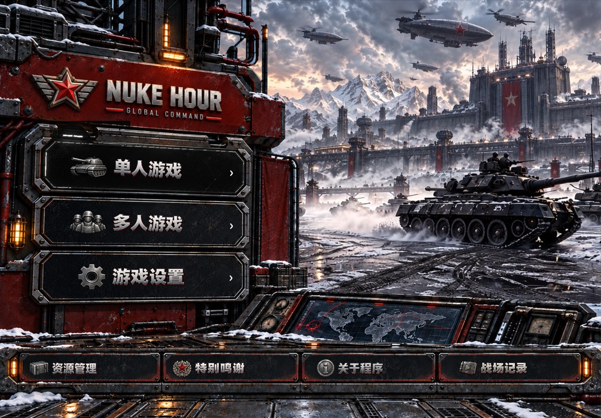
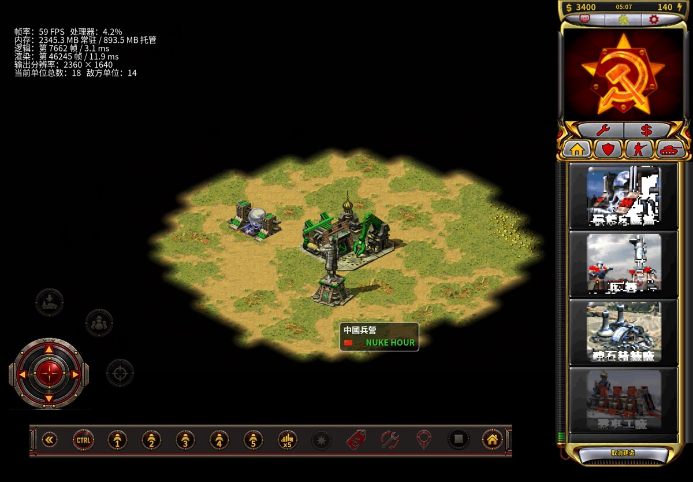
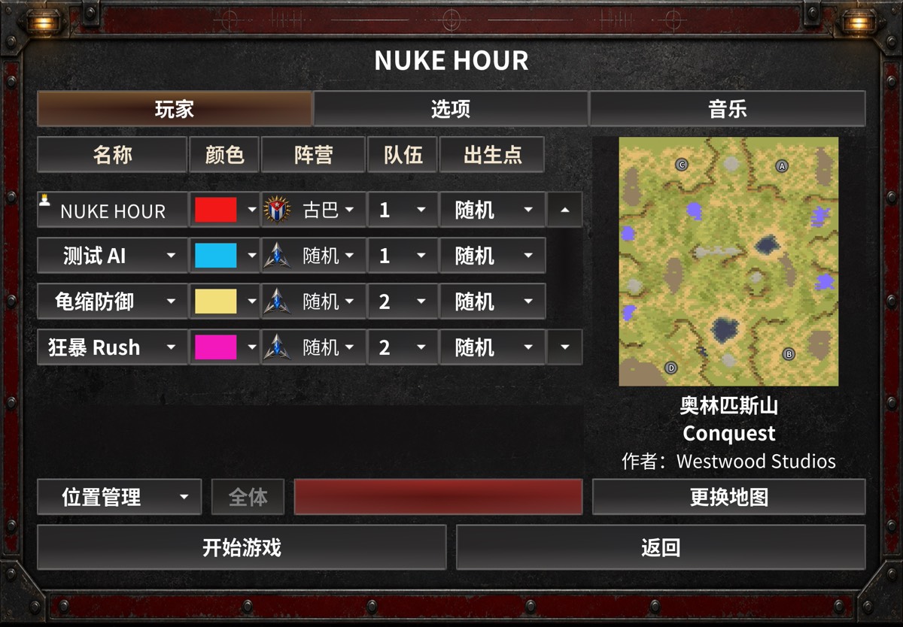

# NUKE HOUR

### Classic real-time strategy. A new touch command.

Red Alert 2 & Yuri’s Revenge gameplay, reimagined for iPhone and iPad with OpenRA.

**iPhone & iPad** · **Touch controls** · **Skirmish & multiplayer** · **Open source**

[Official Website](https://nukehour.com) · [Get Started](docs/getting-started.md) · [Report an Issue](https://github.com/kveinjay-google/NUKEHOUR/issues) · [Developer Guide](BUILDING.md)

## Command the battlefield, wherever you play

Build your base. Manage your economy. Assemble your army. NUKE HOUR brings the familiar rhythm of classic real-time strategy to a native iOS/iPadOS application, with a touch interface built around the battlefield.

Built on **OpenRA and OpenRA RA2**, this independent community project combines classic factions and battlefield systems with mobile controls, a dedicated game-data importer, and local and online multiplayer workflows.

| Made for touch | Built for strategy | Ready to connect |
| :--- | :--- | :--- |
| Virtual joystick, on-screen commands and control groups keep key actions within reach. | Base construction, resource harvesting, production and faction-based combat preserve the core RTS loop. | Configure AI skirmishes, discover nearby games or use the online lobby with compatible clients. |

## The game in your hands

### Build, produce, command

A dedicated production sidebar keeps construction and recruitment beside the action. On-screen control groups and command buttons bring familiar RTS actions to the touchscreen.

### Set up your next battle

Choose a faction, set teams and starting positions, add AI opponents, and select a map before entering a skirmish. English and Simplified Chinese interface options are available.

Actual iPad captures from development Build 169, October 11, 2026, shown in Simplified Chinese. Interfaces vary by build and device. These images illustrate development progress beyond the public Build 18 source snapshot; diagnostic counters in the gameplay capture are not performance guarantees. See the [capture notes](docs/images/README.md).

## Start playing

1. **Check availability.** Visit [nukehour.com](https://nukehour.com) for the project’s current distribution information. This repository provides source code; it does not currently host a downloadable IPA in GitHub Releases.
2. **Bring your game data.** Import files from your own lawful Red Alert 2 / Yuri’s Revenge installation using the app’s content manager. Original game data is not included.
3. **Enter a skirmish or find a game.** Choose your map and opponents. For multiplayer, use clients and servers with matching compatibility versions.

[Read the setup guide →](docs/getting-started.md)

## Project at a glance

| | |
| :--- | :--- |
| **Platforms** | iPhone and iPad; landscape orientation |
| **Public source target** | iOS / iPadOS 15.0 or later; ARM64 |
| **Languages** | English and Simplified Chinese |
| **Engine** | Modified OpenRA / OpenRA RA2 |
| **Game data** | Imported by the player; no retail game installation included |
| **Status** | Actively developed community project; features and compatibility vary by build |
| **Public source snapshot** | iOS / iPadOS 1.0, Build 18; separate from current development builds |
| **License** | GNU GPL v3; third-party components retain their respective licenses |

## For developers

Explore the iOS host, engine changes and multiplayer documentation:

- [Build from source](BUILDING.md) — toolchain and unsigned verification build.
- [Public source release notes](docs/releases/IOS_BUILD_16.md) — source projection and game-data distribution boundary.
- [Online lobby](docs/online-lobby.md) · [Network protocol](docs/network-protocol.md) · [Dedicated server](docs/dedicated-server.md).
- [Contributing](CONTRIBUTING.md) · [Code of conduct](CODE_OF_CONDUCT.md).

The public repository is an audited source snapshot. Its version should not be used to infer the availability or validation status of a newer app build. Historical Build 4 source remains on the `archive/ios-build-4` branch and `ios-build-4` tag.

## Support & feedback

Found a problem? [Open an issue](https://github.com/kveinjay-google/NUKEHOUR/issues/new) with your device model, iOS/iPadOS version, NUKE HOUR build, game mode and steps to reproduce it. For multiplayer issues, include the other clients’ versions. Remove personal information before attaching logs or screenshots.

## Credits & legal

NUKE HOUR builds on the work of the [OpenRA](https://github.com/OpenRA/OpenRA) and [OpenRA RA2](https://github.com/OpenRA/ra2) communities. Red Alert 2 and Yuri’s Revenge names, trademarks and original game content belong to their respective owners. Players must supply their own lawful game data.

**EA has not endorsed and does not support this product.**

[License](LICENSE) · [Source release notice](NOTICE.md) · [Third-party notices](THIRD_PARTY_NOTICES.md)
