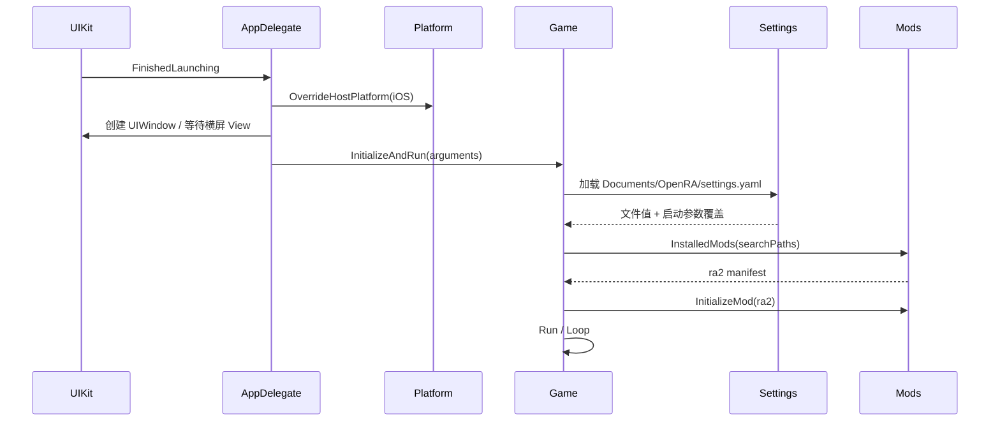

# 启动、平台抽象与 iOS 生命周期

## 已确认的启动链

1. `ios/OpenRA.iOS/AppDelegate.cs` 的 `FinishedLaunching` 最先执行 `Platform.OverrideHostPlatform(PlatformType.iOS)`，随后创建 `ViewController` 和 `UIWindow`。
2. `ViewController.StartInLandscape` 等待横屏 View 可用，再回调宿主启动代码。这样 SDL 创建 drawable 时 UIKit 场景已经具备有效尺寸。
3. AppDelegate 计算 Bundle 资源目录与 `Documents/OpenRA` 支持目录，注册 iOS 平台工厂和内容文件系统加载器，然后调用 `Game.InitializeAndRun`。
4. `engine/OpenRA.Game/Game.cs` 中 `InitializeAndRun` 依次进入 `Initialize` 与 `Run`。`Initialize` 先解析参数、初始化日志和设置，再创建渲染/声音平台、发现 Mod，最后调用 `InitializeMod`。
5. `Game.InitializeSettings` 从 `Platform.SupportDir/settings.yaml` 构造 `Settings`。`engine/OpenRA.Game/Settings.cs` 先加载文件，再用启动参数覆盖同名字段。因此启动参数优先，但未被参数覆盖的用户偏好仍会保留。
6. `Engine.ModSearchPaths` 交给 `InstalledMods` 搜索 Mod manifest；找到 `ra2` 后，`ModData` 再按 `mods/ra2/mod.yaml` 挂载程序集、规则、Chrome、地图与资源。

## 平台识别

`engine/OpenRA.Game/Platform.cs` 的通用检测以 Windows 和 `uname` 为主，在 iOS AOT 宿主中可能把 Darwin 识别为 OSX。因此 iOS 必须在任何读取 `Platform.CurrentPlatform` 的初始化逻辑之前调用 `OverrideHostPlatform(iOS)`。当前 AppDelegate 满足这一时序。

`Platform.IsIOS` 适合保护引擎内部平台差异，但前提是调用发生在宿主覆盖之后。对构造期静态缓存、模块加载早期逻辑仍需逐个确认读取时点。

## 设置与持久化

支持目录是 iPad App 容器内的 `Documents/OpenRA`。卸载 App 通常会删除容器，覆盖安装则保留，因此：

- `settings.yaml` 会跨版本保留，包括用户主动开启的 `Debug.PerfText`。
- 内容包、地图、回放与日志也可能跨覆盖安装保留。
- `Engine.ModSearchPaths` 只决定可发现的 Mod manifest，并不等同于禁止 Mod 自己在 manifest 内挂载 `^SupportDir` 内容。
- `mods/ra2/mod.yaml` 明确允许用户地图来自 `~^SupportDir|maps/ra2/{DEV_VERSION}`，内容资源来自 `~^SupportDir|Content/ra2`。

因此，处理“新版资源未生效”时必须分别检查：Mod 搜索路径、manifest 内包挂载、用户地图覆盖、设置持久化和构建产物复制，不能把它们归为一个缓存问题。

## iOS 生命周期

- `FinishedLaunching`：创建窗口并启动引擎。
- `DidEnterBackground`：暂停卡死看门狗，避免系统挂起时误报。
- `OnActivated`：恢复看门狗。
- OpenRA 主循环仍在 UIKit 主线程运行，因为 SDL UIKit 后端要求窗口/事件操作保留主线程归属。

这是一个重要风险边界：任何逻辑帧中的同步等待都可能同时冻结游戏、触摸响应和画面提交，但不会自动触发崩溃退出。

## 启动序列

## 与当前问题相关的结论

- 右下角性能文本来自持久化设置且由用户主动开启，必须保留。
- 已安装 App 的 RA2 `world.yaml` 不包含 `TerrainGeometryOverlay`，但设备仍显示菱形网格。这排除了“当前 Bundle 中该 Trait 仍被实例化”这一简单解释。
- 下一步必须在绘制阶段记录产生这些线段的 renderable 类型、调用层和颜色来源；在此之前不再调整 Mod 搜索或用户设置。
