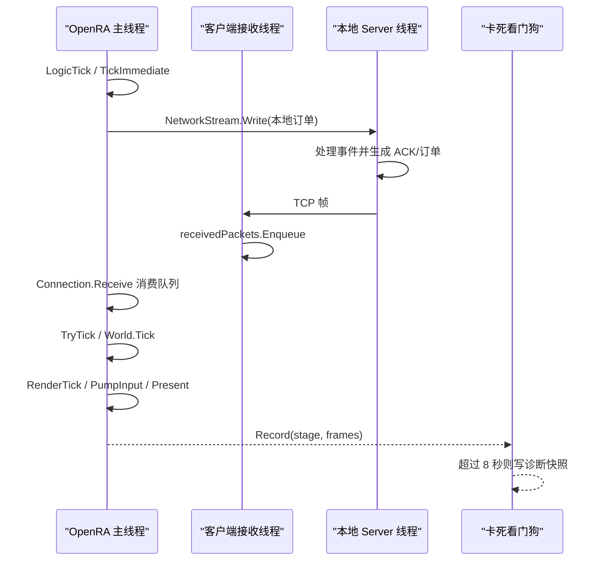

# 游戏循环、网络同步与卡死诊断

## 单线程主循环

`engine/OpenRA.Game/Game.cs` 的 `Loop` 在同一线程调度逻辑和渲染。一次常规迭代的主要边界为：

1. `LogicTick`
2. `InnerLogicTick`
3. `OrderManager.TickImmediate`
4. `IConnection.Receive`
5. `OrderManager.TryTick`
6. `World.Tick`
7. `World.TickRender`
8. `RenderTick`
9. `WorldRenderer.Draw`
10. `WorldRenderer.DrawAnnotations`
11. `Renderer.EndFrame`，其中包含输入泵和最终提交

因此主线程在任何一步同步阻塞时，逻辑、触摸、画面和 UIKit 事件会一起停住。进程仍然存在，不会自动退出，这与用户观察到的“画面定住、按任何按钮无反应”一致。

## 本地遭遇战也使用 TCP

`Game.CreateLocalServer` 并不使用 `EchoConnection`，而是在 `127.0.0.1` 随机端口创建真实 `Server`，客户端仍使用 `NetworkConnection`。相关线程包括：

- UIKit/OpenRA 主线程：游戏逻辑、绘制和客户端队列消费。
- `NetworkConnection (connect ...)`：异步建立 TCP。
- `NetworkConnection (receive ...)`：阻塞读取 TCP 后压入 `receivedPackets`。
- Server 主线程：消费 `IServerEvent`、执行 Server Trait、调度订单。
- 每个 Server Connection 的收发线程。
- iOS hang watchdog 后台线程。

这意味着“单机游戏”仍可能出现本地网络队列、服务器线程或 socket 写入方面的问题。

## 订单节拍

`OrderManager.TickImmediate` 先发送即时订单，再调用 `Connection.Receive`。`TryTick` 仅在网络帧需要的玩家订单全部到齐后推进：

- 本地订单由 `NetworkConnection.Send` 写入 TCP，并同时加入 `sentOrders`。
- Server 返回 ACK，客户端在 `NetworkConnection.Receive` 中把对应 `sentOrders` 转入 `pendingOrders`。
- `IsReadyForNextFrame` 为真后，`ProcessOrders` 执行订单并增加 `NetFrameNumber`。
- 非网络帧只增加 `LocalFrameNumber`。

## 已捕获卡死的准确含义

看门狗记录的最后边界是 `logic.network-receive.enter`，当时：

- `LogicFrame: 0`
- `NetworkFrame: 0`
- `ConnectionState: Connected`
- 渲染此前已推进到数百帧

该证据把停点限定在 `Sync.RunUnsynced(world, orderManager.TickImmediate)` 内，但不能直接解释成“后台 socket read 阻塞”，因为 `NetworkConnection.Receive` 本身只轮询并消费内存队列，不读取网络流。

此边界内仍包含两类可同步阻塞或长时间执行的操作：

1. `SendImmediateOrders -> NetworkConnection.Send -> NetworkStream.Write`：主线程同步写 TCP，没有显式超时。
2. 对本地/远端即时订单调用 `ReceiveImmediateOrders -> UnitOrders.ProcessOrder`：订单处理可以切换 Mod、创建世界、执行复杂回调或释放当前连接。

所以目前最严谨的诊断是：**卡死发生在即时订单发送或即时订单处理阶段；现有 breadcrumb 粒度不足以区分二者。**

## 现有日志系统

OpenRA 内置按 channel 写文件的异步日志系统，常用日志包括 `debug.log`、`graphics.log`、`client.log`、`server.log`、`exception.log`、`perf.log` 与同步报告。iOS 新增的 `hang-diagnostic.log` 位于 `Documents/OpenRA/Logs`，使用 `FileOptions.WriteThrough` 写入，降低冻结后证据尚未落盘的概率。

看门狗每秒检查一次；主循环超过 8 秒无 heartbeat 时记录：

- 最后阶段
- 停滞时长
- 逻辑、渲染、网络帧
- 连接状态
- 托管内存和工作集
- 最近 64 个 breadcrumb

进入后台时暂停、回到前台后恢复，避免 iOS 正常挂起被误判。

## 观测缺口与下一步插桩

当前需在不改变游戏行为的前提下增加以下边界：

- `network.immediate-send.enter/exit`
- `network.receive.local-immediate.enter/exit`，包含订单数量
- `network.receive.remote-packet.enter/exit`，包含包类型与队列长度
- `orders.immediate.process.enter/exit`，包含 order 类型和 subject actor
- socket 写前后的字节数和耗时
- Server 最后处理的 event、订单帧、ACK 帧和连接发送队列状态

这样下一次冻结可以区分 socket backpressure、即时订单回调、服务器未 ACK、锁竞争和大队列耗尽。

## 时序图

## 风险等级

| 风险 | 证据 | 当前置信度 |
|---|---|---|
| 主线程同步 `NetworkStream.Write` 无限等待 | 源码无写超时，且位于捕获边界内 | 中 |
| 即时订单处理内部死循环/锁等待 | 同样位于捕获边界内 | 中 |
| 后台 socket `Read` 直接冻结主线程 | Read 在独立线程，仅入队 | 低，现有证据反对 |
| 逻辑等待网络帧导致 UI 完全冻结 | `TryTick` 不就绪时会返回，主循环仍应渲染/泵输入 | 低 |
| UIKit 后台挂起造成误报 | 生命周期已暂停看门狗 | 低 |
