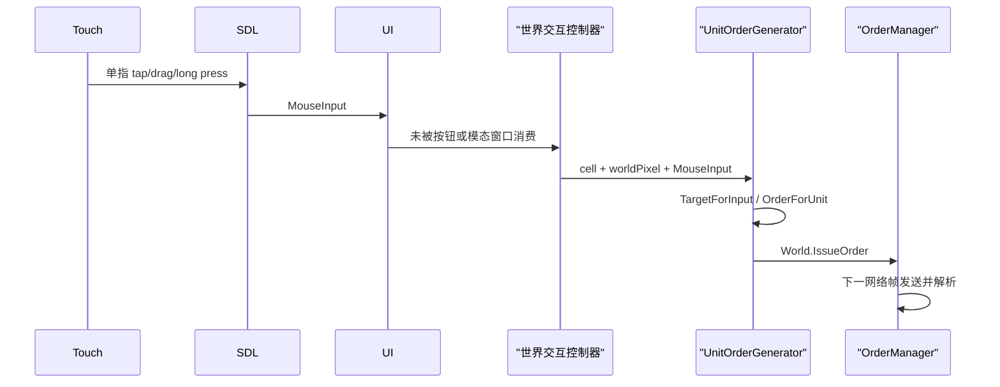

# 输入、触摸、命令与 UI

## iOS 输入桥

iOS 的触摸不是独立的游戏命令系统，而是由 `engine/OpenRA.Platforms.Default/Sdl2Input.cs` 把 SDL finger events 转译成现有鼠标事件。核心状态机在 `engine/OpenRA.Game/Input/TouchGestureAdapter.cs`：

| 手势 | 生成的 OpenRA 输入 |
|---|---|
| 单指轻点 | LeftDown + LeftUp |
| 单指移动超过 8 逻辑像素 | LeftDown + LeftMove，结束时 LeftUp |
| 450ms 长按后松开 | RightDown + RightUp |
| 双指移动 | MiddleDown/Move/Up，用于视口拖动 |
| 双指距离变化超过 12 像素 | 带 ZoomModifier 的 Scroll |
| 三指拖动 | 独占 MiddleDown/Move/Up，以三指质心增量平移视角 |

触点坐标从 SDL `[0,1]` 归一化值映射到 `EffectiveWindowSize`，随后进入 `DefaultInputHandler -> Ui.HandleInput`。Widget 树自顶向下处理，当前 mouse-focus Widget 优先；未被 UI 消费的世界区域事件最终进入世界交互控制器和当前 `IOrderGenerator`。

SDL 的 iOS 后端还会为同一触摸生成兼容鼠标事件，其 `which` 为保留值 `SDL_TOUCH_MOUSEID`（`uint.MaxValue`）。如果 finger 与合成 mouse 两路都进入 Widget，拖选会先按错误缩放坐标创建选框，再按 finger 的正确坐标创建第二个选框，两套 drag state 竞争并闪烁。当前 `Sdl2Input` 在 iOS 丢弃这种合成 mouse button/motion/wheel 事件，只保留 finger 转译流；普通 device id 的外接鼠标事件不受影响。平台无关判定在 `TouchMouseEventFilter`，由单元测试覆盖。

三指加入时，adapter 先结束原有双指 Middle 流，再以三指质心重启独占 Middle 流。任意参与手指松开都会结束平移，并吞掉其余两个 release，防止残余触点变成点击或选框。左下角 `VirtualViewportJoystickWidget` 为 112×112 逻辑像素固定摇杆，采用 15% 径向死区、位移比例速度和松手回中；控件位于世界输入层之后，逆序命中时优先消费其区域内输入。

## 输入恢复

触摸状态跨窗口焦点或生命周期变化残留时，后续输入会表现为“所有按钮没反应”或持续拖动。当前代码在以下事件调用 `ResetTouchInput`：

- window focus lost
- window hidden/minimized
- 多指手势释放顺序不完整后出现新手指

Reset 会让 gesture adapter 生成必要的 LeftUp/MiddleUp，清除 finger id 和 `lastButtonBits`，并在 iOS debug 日志记录原因。双指结束后还会忽略剩余手指的 release，避免它被误识别成一次新点击。

## 世界命令链

单指轻点生成左键。iOS 启动参数启用 `Game.UseClassicMouseStyle=true`，所以 Action 是左键、Cancel 是右键。

`UnitOrderGenerator.OrderForUnit` 的主要门槛是：Action 按钮正确、Actor 属于本地玩家、游戏未结束、Actor/Target 有效，并且某个 `IIssueOrder` 的 `IOrderTargeter.CanTarget` 接受目标。选中单位后点击地图时，Mobile trait 应提供 Move 目标器；订单随后经本地 TCP Server 回到 `UnitOrders.ProcessOrder`。

## MCV 移动与展开

三种基地车分别为：

- 盟军 `amcv -> gacnst`
- 苏军 `smcv -> nacnst`
- 尤里 `pcv -> yacnst`

每个基地车继承 `^Vehicle`，具有 `Mobile` 和 `Transforms`：

- 移动：`Mobile` 的 `IIssueOrder` 生成 Move，解析后排入移动 Activity。
- 展开：`Transforms` 同时实现 `IIssueOrder` 与 `IIssueDeployOrder`。双击/目标器或底部 Deploy 按钮均可生成 transform order。
- 命令栏 Deploy：`CommandBarLogic` 从选中 Actor 收集所有 `IIssueDeployOrder`，检查 `CanIssueDeployOrder`，再调用 `IssueDeployOrder`。
- `Transforms` 检查暂停/禁用状态、目标建筑 footprint 和放置条件，然后把基地车替换为对应 Construction Yard。

因此“既不能移动也不能展开”更像命令输入未到达世界或主循环停在逻辑边界，而不是三个独立 Trait 同时失效。若只有展开失效，则应检查 `Transforms` 的 footprint/terrain/occupied-cell 失败路径和通知；若移动也失效，先检查 selection ownership、Action button、Widget 消费与订单日志。

## Widget 与 Chrome

MiniYAML Chrome 定义树形 Widget，C# ChromeLogic/Widget 类绑定行为。RA2 的主要入口来自 `mods/ra2/mod.yaml` 的 `ChromeLayout`：

- `mods/ra2/chrome/ingame-player.yaml`：侧边栏与命令栏布局。
- `engine/OpenRA.Mods.Common/Widgets/Logic/Ingame/CommandBarLogic.cs`：标准命令按钮状态和订单。
- `OpenRA.Mods.RA2/Widgets/CustomCommandBarWidget.cs`：RA2 自定义底栏、编辑/折叠和 iOS 44px 紧凑按钮。
- `mods/ra2/chrome/settings.yaml` 及 common settings 页面：设置导航与面板。

Widget 输入遵循 mouse focus、可见性、禁用状态和子节点逆序命中。触屏改版不能只放大图片：必须同时扩大 `Bounds`、命中区域、行距和滚动容器，并验证模态遮罩没有覆盖世界区域。

## 风险与测试重点

- iOS 通过 `OperatingSystem.IsIOS()` 选择触摸路径，而部分引擎策略使用 `Platform.IsIOS`；两套平台判断必须保持一致。
- Gesture 阈值单位是逻辑像素，会受 EffectiveWindowSize/UI scale 影响。
- 长按只在松开时产生右键，用户没有按压过程的视觉确认。
- 双指平移使用 Middle；ViewportController 的 scroll button 配置和经典鼠标模式需要共同验证。
- 自定义命令栏会暂存并替换按钮 `OnMouseDown`，必须确保刷新/折叠后正确恢复 handler。
- 测试不能只验证 adapter 输出，还需验证 Widget 命中、selection、Move/Deploy order 进入 OrderManager 以及后台恢复后的新 tap。
