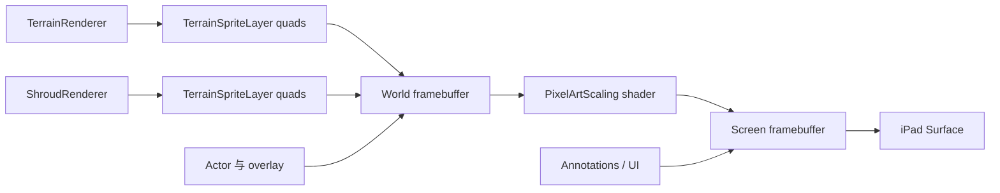

# 渲染、地形、迷雾与网格纹路

## 一帧的绘制层次

`Game.RenderTick` 调用 `WorldRenderer.PrepareRenderables`，随后世界绘制与 UI/注释绘制分开进行：

1. `TerrainRenderer.RenderTerrain`
2. 常规 Actor/Effect renderables
3. `IRenderAboveWorld`
4. `IRenderShroud`，RA2 使用 `ShroudRenderer`
5. above-shroud overlay renderables
6. after-shroud post-process
7. `IRenderAnnotations`
8. 可选 renderable debug geometry 与 screen-map bounds
9. Chrome/UI 与光标
10. world framebuffer 缩放到 screen framebuffer，再提交

## 能画菱形的候选路径

| 路径 | 形状/范围 | 与截图是否吻合 |
|---|---|---|
| `TerrainGeometryOverlay` | 沿 ramp polygon 画线，使用 `HeightDebugColors`；明确跳过未探索格 | 不吻合：截图黑色未探索区也有纹路 |
| `DebugVisualizations.RenderGeometry` | Sprite 边界通常是红色矩形/旋转四边形 | 不吻合：不是全图等距菱形 |
| `ScreenMap` | 绿色矩形 bounds | 不吻合 |
| `PathFinderOverlay` | 搜索/路径诊断，受开关和状态约束 | 不吻合全图常驻纹理 |
| `MarkerTileRenderable` | 填充单格，不画边线 | 不吻合 |
| Terrain/Shroud `TerrainSpriteLayer` | 每地图格一个纹理 quad，地形和迷雾都使用 | 高度吻合，尤其能解释未探索区同样出现 |
| 世界 framebuffer 缩放采样 | 会把已有每格纹理边缘统一放大 | 可能放大问题，但不足以单独产生菱形内容 |

## 已证伪的原判断

最初根据外观把纹路归因于 `TerrainGeometryOverlay`，并尝试从 RA2 `world.yaml` 移除 Trait。设备截图证明纹路不变。源码进一步确认该 Trait 在 `RenderAnnotations` 中调用 `World.ShroudObscures(uv)` 并跳过未探索格，而用户截图中黑色未探索区域仍完整显示菱形纹路。

因此，移除 Trait 和调试菜单入口属于无效修复，已经精确撤回，桌面端调试功能保持不变。

## 当前最强假设：瓦片纹理采样缝

地形、资源、迷雾均由 `TerrainSpriteLayer` 预建每格四顶点 quad，并从 Sprite Sheet 采样。RA2 的黑色未探索区域由 `ShroudRenderer` 使用相同 `TerrainSpriteLayer` 绘制 `shroud.shp`；截图中纹路跨越可见地形和黑色迷雾，说明共同基础设施比单一覆盖 Trait 更可疑。

关键细节：

- `Sprite` 只把 UV 向内收缩 `1/128` 像素，用于缓解非 1:1 framebuffer 的越界采样。
- `Texture` 使用 `GL_NEAREST`（默认）及 `GL_CLAMP_TO_EDGE`。
- 世界先绘制到 power-of-two framebuffer，再用线性过滤和像素艺术 shader 缩放到屏幕。
- iPad 截图显示 viewport 与 world framebuffer 尺寸不同，存在一次 framebuffer 采样变换。
- 如果 GLES 的坐标精度、图集边缘、UV 插值或 framebuffer 缩放与桌面不同，邻接 sprite 的非透明边缘可能变成规则菱形缝。

此项仍是“强假设”，尚未完成物理设备 A/B 验证。下一步应分别测试：增大 Sprite UV inset、对 TerrainSpriteLayer 使用半 texel 内缩、禁用 world framebuffer 像素艺术缩放、以及直接检查 shroud/terrain sheet 边缘像素。每次只改一个变量并截图对比。

## iOS 平台差异

- iOS 使用 OpenGL ES profile；纹理内部格式走 `GL_RGBA` 兼容路径，外部上传格式为 `GL_BGRA`。
- GLSL ES fragment shader 默认 `mediump float`，桌面 shader 没有该精度限制。大纹理 UV 与插值精度可能不同。
- iPad Surface、逻辑 viewport、world framebuffer 可以具有不同尺寸和缩放比例。
- `Platform.IsIOS` 仅能关闭明确走 `DebugVisualizationPolicy` 的调试绘制，无法影响 TerrainSpriteLayer 采样缝。

## 需要的验证矩阵

1. 新游戏初始黑色迷雾：检查纹路是否每格一致。
2. 开启/关闭 `TerrainGeometryOverlay`：确认纹路完全不变。
3. 暂时禁用 `ShroudRenderer`：区分黑区纹路是否来自 shroud sheet。
4. 把 shroud 完全覆盖帧替换成单色 RGBA sprite：检查菱形是否消失。
5. 增大 UV inset 的单变量构建：截图比较可见地形和迷雾。
6. shader 改为 `highp float` 的单变量构建：排查 GLES mediump UV 精度。
7. 禁用 world framebuffer PixelArtScaling：排查二次采样。
8. 每个构建核对 App bundle 中 DLL、shader 和 Mod 文件哈希后再安装。

## 渲染流程

## 性能文本与运行时资源

性能文本由 `DebugSettings.PerfText` 控制，界面入口仍是现有性能显示开关。`PerfDebugLogic` 组合以下数据：

- 最近约一秒渲染帧的 rolling FPS；
- `RuntimeResourceSampler` 每 500ms 采集的游戏进程 CPU、resident memory 与 managed GC heap；
- `PerfHistory` 中的 tick/render 平均耗时和 batch 数；
- `Renderer.OutputSize` 的物理输出分辨率；
- `WorldRenderer.Viewport` 的逻辑视口及 world downscale；
- `Renderer.WorldFrameBufferSize` 的世界缓冲区尺寸。

CPU 是两次 `Process.TotalProcessorTime` 的增量除以单调时钟增量，再除以逻辑处理器数量，因此表示游戏进程占整台设备总计算能力的百分比（0–100%），不是单核心百分比或全系统 CPU。Resident memory 是进程常驻内存，managed memory 是 GC heap，两者不可相加理解为总内存。系统 API 异常会被采样器捕获并显示 `N/A`，避免诊断面板反过来中断游戏。
